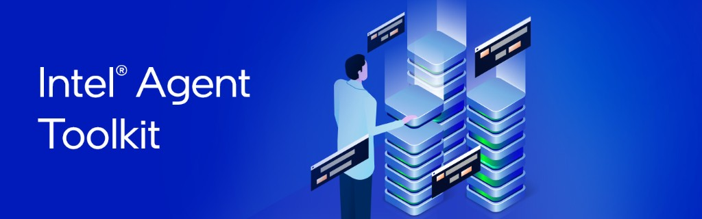

<!-- vale off (due to hyperlinks) -->
[](https://github.com/intel/agent-toolkit/blob/main/LICENSE)
[](https://www.intel.com/xeon)
[](https://www.intel.com/content/www/us/en/products/details/discrete-gpus.html)
[](https://kubernetes.io)
[](https://litellm.ai)
[](https://github.com/intel/agent-toolkit)
<!-- vale on -->

# Intel® Agent Toolkit

**Quickly deploy a production-ready, open source agentic AI stack.**

> A Kubernetes platform with an API gateway, inference routing, agent memory, sandboxed code execution, MCP tools, and observability. Toolkit Manager installs the cluster and these pieces for you.

---

Teams that want **production AI agents** usually discover that a language-model endpoint is not enough. An agent has to remember a conversation, look up company data, call internal APIs, and sometimes run code it just generated. Doing that on a public cloud API also means prompts and documents leave the premises, and every team rebuilds the same plumbing: a gateway (LiteLLM), memory (Redis and pgvector), a sandbox, and traces (Langfuse).

Intel® Agent Toolkit is that plumbing, running on Kubernetes on **Intel® hardware** you already operate. [Toolkit Manager](https://github.com/intel/toolkit-manager) installs, updates, and tears it down, including the cluster and model serving. Applications keep an **OpenAI-compatible API**, so developers change the base URL and the API key and keep using LangGraph, CrewAI, or a similar framework. Data and weights stay on your hardware. A GPU is not required, because memory, tools, and coordination run on the CPU, while a GPU or a cloud model can still answer the language-model call when you want that.

<p align="center">
  
</p>

---

## What you get

A default install gives you the components below. Every one of them is configurable: turn it off, change its settings, or bring your own (an existing cluster with `existing_kubernetes`, Keycloak instead of LiteLLM, the models you list in `llm_services_autodeploy_models`). See [Configuration](docs/configuration/configuration.md).

| Component | Implementation | Purpose |
|---|---|---|
| **API gateway** | LiteLLM (or Keycloak in front of the AI gateway) | A single HTTPS URL and key for every model |
| **Model serving** | Optimized OpenAI-compatible runtimes on Intel® hardware | The language model the agent calls |
| **Short-term memory** | Redis Stack (with RediSearch) | Session state and recent context |
| **Long-term memory** | PostgreSQL + pgvector | RAG, embeddings, and data that persists across restarts |
| **Sandbox** | Agent Sandbox + OpenShell | Deploy agents and run their code securely, isolated from the host |
| **Tools** | MCP server templates | Register APIs and tools the agent can invoke |
| **Guardrails** | LiteLLM content safety + guard model | Screen each prompt before the main model |
| **Observability** | Langfuse + Prometheus / Grafana | Tokens, latency, and each agent step |

Out of the box, Redis, pgvector, and the sandbox are on; each has an `*_enabled` flag to switch it off. MCP templates are installed, but no MCP server runs until you add one. KubeRay (distributed Ray jobs) is off until you set `kuberay_enabled: true`.

Agents are written in LangGraph, CrewAI, or any OpenAI-compatible SDK. This repository is the infrastructure those frameworks call; it does not replace them.

---

## Quickstart

Start here to run the agent platform on one host. Toolkit Manager installs Kubernetes and the components in the table above, plus one chat model. The last step calls the gateway so you can see that it answers.

Run the commands on that host as a non-root user with `sudo`. The installer logs in over SSH, including to the machine you are on. With the example domain `api.example.com`, the API is `https://litellm.api.example.com`.

### 1. Prepare the host

Use Ubuntu 22.04 or 24.04 on a 64-bit Intel® processor, with 48 cores, 150 GB of free disk, and a network that can download container images. The OS boots in 32 GB, but the default model needs about 131 GB, so on a server with 128 GB set the model to `qwen2-5-coder-7b` or `llama-3-1-8b` in step 3. DNS and certificates are in [Prerequisites](docs/getting-started/prerequisites.md).

```bash
# Raise the kernel file-watch limit the containers need.
sudo tee /etc/sysctl.d/90-inotify.conf > /dev/null <<'EOF'
fs.inotify.max_user_instances = 8192
fs.inotify.max_user_watches   = 1048576
EOF
sudo sysctl --system

# Create an SSH key so the installer can log in to this machine.
[ -f ~/.ssh/id_rsa ] || ssh-keygen -t rsa -b 4096 -N "" -f ~/.ssh/id_rsa
cat ~/.ssh/id_rsa.pub >> ~/.ssh/authorized_keys && chmod 600 ~/.ssh/authorized_keys
ssh -o StrictHostKeyChecking=accept-new -o BatchMode=yes localhost true && echo "SSH OK"
```

Go on to the next step when that last command prints `SSH OK`. You will add the gateway name to `/etc/hosts` in step 5, once the install has given you an IP address for it.

### 2. Install Toolkit Manager and generate the configuration

```bash
git clone -b release-1.2 https://github.com/intel/toolkit-manager.git
cd toolkit-manager
./toolkit_manager.sh configure
./toolkit_manager.sh init agent-toolkit
```

Run the rest of this quickstart from the `toolkit-manager` directory, because `init` has cloned this repository under `ext/` and written the configuration you are about to edit.

### 3. Set the configuration

`init` writes the files under `env/local/`. Set the domain there, and change the model only when you do not want the default, leaving the other keys as `init` wrote them.

| File | Setting | Purpose |
|---|---|---|
| `global_config.yaml` | `base_domain_name: api.example.com` | Domain. The API is `https://litellm.api.example.com`. |
| `global_config.yaml` | `auth_provider: litellm` | LiteLLM gateway. The default written by `init` is already `litellm`. |
| `config.agent-toolkit.yaml` | `llm_services_autodeploy_models: ["qwen2-5-coder-14b"]` | Default chat model. Names must match `models.yaml`. |

`gateway_tls_mode: selfsigned` tells the installer to generate the certificate, and `storage_backend: local-path` keeps the data on this host.

### 4. Install

```bash
export HF_TOKEN=hf_xxxxxxxxxxxxxxxxxxxx   # only for a gated model (Llama, Gemma)
./toolkit_manager.sh install agent-toolkit
```

The first install usually takes 20–40 minutes, and the model pod can spend another 10–15 minutes downloading weights after that. If the command stops before it finishes, run it again and it will pick up at the step that did not complete. You use that same command later, whenever you change the YAML and want the cluster to match it.

### 5. Verify

```bash
export KUBECONFIG=$(pwd)/env/local/kubeconfig.yaml
kubectl get nodes
kubectl get pods -A

GW=$(kubectl get svc -n envoy-gateway-system \
  -l gateway.envoyproxy.io/owning-gateway-name=eg-gateway \
  -o jsonpath='{.items[0].status.loadBalancer.ingress[0].ip}')
echo "$GW"
grep -q "litellm.api.example.com" /etc/hosts || \
  echo "$GW litellm.api.example.com langfuse.api.example.com" | sudo tee -a /etc/hosts

export LITELLM_MASTER_KEY=$(kubectl get secret litellm-master-key -n litellm \
  -o jsonpath='{.data.master_key}' | base64 -d)

curl -k https://litellm.api.example.com/v1/models \
  -H "Authorization: Bearer ${LITELLM_MASTER_KEY}"

curl -k https://litellm.api.example.com/v1/chat/completions \
  -H "Content-Type: application/json" \
  -H "Authorization: Bearer ${LITELLM_MASTER_KEY}" \
  -d '{"model": "qwen2-5-coder-14b",
       "messages": [{"role": "user", "content": "Write a Python hello world"}],
       "max_tokens": 100}'
```

A working platform lists `qwen2-5-coder-14b` from `/v1/models` and returns the model's reply in `choices[0].message.content`. Pass `-k` on those `curl` commands because the certificate was signed by the installer. Redis, pgvector, and the sandbox are already running behind that gateway, and their addresses inside the cluster are in the [backend connection reference](docs/reference/backend-connections.md).

| Symptom | Resolution |
|---|---|
| `Could not resolve host` | The `/etc/hosts` line is missing or uses the wrong IP. Rerun the `GW=` commands. |
| `401` | `LITELLM_MASTER_KEY` is not set in this shell. Rerun the `export`. |
| `model not found` | Use the `id` returned by `/v1/models`. The default id is `qwen2-5-coder-14b`. |
| `500`, `503`, or a timeout | The model is still loading. Wait until its pod is `1/1 Running`, then retry. |
| Pods stuck, `too many open files` | The inotify sysctl from step 1 was not applied on this node. |

Point an OpenAI-compatible client at `https://litellm.api.example.com/v1` and give it the master key from the command above, because that is the URL an agent uses for every model call. Once this request succeeds, [build a first agent](docs/getting-started/first-agent.md) against the same gateway. The [single-node quickstart](docs/getting-started/quickstart.md) walks through this same install with the field-by-field reference, and [Troubleshooting](docs/faq-and-troubleshooting/troubleshooting.md) covers the install and API failures that show up after it.

---

## Choose how to run it

| Path | Best for | Guide |
|---|---|---|
| **Single node** | The agent platform on one machine. Start here. | [Single-node quickstart](docs/getting-started/quickstart.md) |
| **Multi-node** | One control plane plus workers | [Multi-node](docs/deployment/multi-node.md) |
| **Docker Compose** | Containers on one Linux host, without Toolkit Manager | [Docker](docs/deployment/docker.md) |

Also available: [rack-scale networking](docs/deployment/rack-scale.md) and [Intel® Arc™ (GPU)](docs/deployment/intel-arc.md).

---

## Documentation

The map of every guide is the [docs index](docs/README.md). Start here:

- [Meet the Agent Toolkit](docs/overview/meet.md)
- [Prerequisites](docs/getting-started/prerequisites.md)
- [Single-node quickstart](docs/getting-started/quickstart.md)
- [Troubleshooting](docs/faq-and-troubleshooting/troubleshooting.md)

Related software Toolkit Manager can install: [Intel® Inference Toolkit](https://github.com/intel/inference-toolkit) and [Intel® Chatbot Toolkit](https://swcatalog.intel.com/developer/docs/enterprise-rag).

> Discover more Intel® AI software on the [Intel® Software Catalog](https://swcatalog.intel.com/).

---

## Contributing

Bug reports, doc fixes, and new components are all welcome. [CONTRIBUTING.md](CONTRIBUTING.md) starts with a table of what to do for each kind of change, then walks through your first pull request.

---

## License

Licensed under the [Apache License, Version 2.0](https://github.com/intel/agent-toolkit/blob/main/LICENSE).
