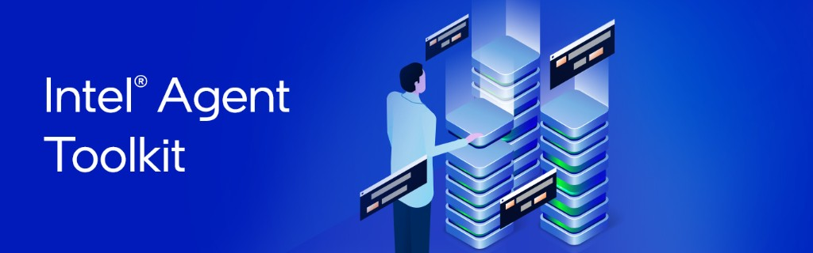

# Intel® Agent Toolkit documentation

  

This is the technical documentation for Intel® Agent Toolkit. Every guide below links back here and to its related pages. If you have not used the stack before, start with **Meet** so you know what you are installing and which repository to clone. Then use **Get started** to stand it up on one host. **Deploy** covers other layouts (several nodes, Docker, teardown). After that, customize the YAML, operate the running cluster, and look things up in **Reference**. To help improve the toolkit, see **Contribute**.

> **Toolkit Manager** installs, updates, and tears down Intel® Agent Toolkit. Clone [that repository](https://github.com/intel/toolkit-manager), run every command from its root, and `init agent-toolkit` clones this repository under `ext/`. [Meet the Agent Toolkit](overview/meet.md) is the walkthrough.

## Meet

These pages describe what the toolkit is, how Toolkit Manager installs it, and the words the rest of the docs use.

| Guide | What it covers |
|---|---|
| [Meet the Agent Toolkit](overview/meet.md) | What the toolkit is, why it exists, when to use it, and which repository to start from |
| [FAQ](faq-and-troubleshooting/frequently-asked-questions.md) | Short answers to the questions that come up most often after a first read |
| [Glossary](reference/glossary.md) | Terms used in these guides, defined in one place |

## Get started

Confirm the host is ready, run the installer on that single node, send a chat request to the OpenAI-compatible API, then build an agent on it.

| Guide | What it covers |
|---|---|
| [Prerequisites](getting-started/prerequisites.md) | Hardware, SSH keys, DNS (or `/etc/hosts`), and TLS |
| [Quickstart](getting-started/quickstart.md) | From `init agent-toolkit` through a working `/v1/chat/completions` endpoint, end to end |
| [Build your first agent](getting-started/first-agent.md) | A LangChain agent with a tool, called through the gateway and traced in Langfuse |

## Deploy

The same installer can place the stack on more than one node, or you can run a smaller container-only layout. This section also covers tearing everything down and working through a corporate HTTP proxy.

> [!WARNING]
> **Not in this release:** [rack-scale networking](deployment/rack-scale.md) and Intel® Arc™ (XPU). [Docker Compose](deployment/docker.md) is a separate path (`docker/deploy.sh`). It is not what `./toolkit_manager.sh install agent-toolkit` does.
>
> [Deploy on multiple nodes](deployment/multi-node.md) is the multi-host layout Toolkit Manager installs today.

| Guide | What it covers |
|---|---|
| [Deploy on multiple nodes](deployment/multi-node.md) | One control plane plus worker nodes, including the inventory YAML Kubespray uses |
| [Docker Compose](deployment/docker.md) | Containers on a single Linux host, via `docker/deploy.sh`. Not the Toolkit Manager install |
| [Rack-scale AI fabric](deployment/rack-scale.md) | **Not in this release.** High-speed fabric and NVMe Ceph |
| [Decommission and redeploy](deployment/decommission.md) | How to tear the toolkit (or the whole install) down and install again |
| [Corporate proxy](deployment/proxy.md) | Setting `http_proxy`, `https_proxy`, and `no_proxy` so image pulls and model downloads work |

Toolkit Manager can also install other software. Those guides use this structure on the Intel® Software Catalog:

| Software | Commands | Documentation |
|---|---|---|
| Intel® Inference Toolkit | `init inference` / `install inference` | [GitHub](https://github.com/intel/inference-toolkit) |
| Intel® Chatbot Toolkit | `init erag` / `install erag` | [Software Catalog](https://swcatalog.intel.com/developer/docs/enterprise-rag) |

## Customize

After the first install you can change models, routing, and content-safety screening by editing YAML and re-running `install`. You do not need to hand-edit Helm values for these. Hybrid routing is on by default (`hybrid_router_enabled: true`).

| Guide | What it covers |
|---|---|
| [Configuration](configuration/configuration.md) | The files under `env/local/`: `global_config.yaml`, `config.agent-toolkit.yaml`, `config.inference.yaml`, and `models.yaml` |
| [Guardrails](configuration/guardrails.md) | A small safety model that screens each prompt before the main language model sees it |
| [Routing](configuration/routing.md) | A virtual model name: the stack selects which deployed model serves the request |
| [Hybrid router](configuration/hybrid-router.md) | Complexity- and cost-aware routing inside LiteLLM |

## Operate

Once the cluster is up, these pages help you watch it, migrate from the old standalone stack, and fix common failures.

| Guide | What it covers |
|---|---|
| [Troubleshooting](faq-and-troubleshooting/troubleshooting.md) | Installer, API, Redis, and model-pod failures, with the command to run for each |
| [Validate the stack](../docs/validate-stack.md) | Preflight, `./toolkit_manager.sh validate`, and the health report under `env/<name>/logs/` |
| [Migration from the monolith](../MIGRATION-GUIDE.md) | Where features from the old standalone stack live now that Toolkit Manager installs them |

## Reference

What the layer exposes inside the cluster, and how agent applications connect to it.

| Guide | What it covers |
|---|---|
| [Backend connection reference](reference/backend-connections.md) | Redis, pgvector, sandbox, and gateway URLs, plus how to read Kubernetes secrets |
| [Agent sandbox](reference/agent-sandbox.md) | Isolated pods for agent-generated code: templates, warm pools, and the SDK |
| [KubeRay](reference/kuberay.md) | Ray jobs inside the cluster. Disabled by default until you turn it on |
| [Glossary](reference/glossary.md) | Terms used across these guides, each linked to the page that owns it |

## Contribute

Report a bug, fix a guide, or add a component. The guide starts with a table: find what you want to do and follow that row.

| Guide | What it covers |
|---|---|
| [Contributing](../CONTRIBUTING.md) | What to do for each kind of change, your first pull request, the checks that run, and how to add a component |
