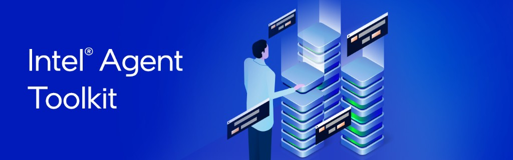

# Intel® Agent Toolkit documentation

  

Start with the table. Each row is one job and one page. The sections under it are the same pages, grouped by folder, for when you already know the area.

> **Toolkit Manager** installs, updates, and tears down Intel® Agent Toolkit. Clone [that repository](https://github.com/intel/toolkit-manager), run every command from its root, and `init agent-toolkit` clones this repository under `ext/`. [Meet the Agent Toolkit](overview/meet.md) is the walkthrough.

## Find a page

| I want to… | Page |
|---|---|
| Understand the stack and which repository to clone | [Meet the Agent Toolkit](overview/meet.md) |
| Check hardware, SSH, DNS, and TLS before installing | [Prerequisites](getting-started/prerequisites.md) |
| Install on one host and call `/v1/chat/completions` | [Quickstart](getting-started/quickstart.md) |
| Call the gateway from a LangChain agent | [Build your first agent](getting-started/first-agent.md) |
| Install on one control plane plus workers | [Multi-node](deployment/multi-node.md) |
| Run containers on one Linux host, without Toolkit Manager | [Docker Compose](deployment/docker.md) |
| Reach the internet through a corporate proxy | [Corporate proxy](deployment/proxy.md) |
| Tear the install down and install again | [Decommission](deployment/decommission.md) |
| See which YAML file holds a setting | [Configuration](configuration/configuration.md) |
| Choose, size, or add a model | [CPU model configuration](configuration/xeon-models.md) |
| Screen each prompt before the main model | [Guardrails](configuration/guardrails.md) |
| Send a prompt to one of several models | [Routing](configuration/routing.md) and [Hybrid router](configuration/hybrid-router.md) |
| Copy Redis, pgvector, sandbox, and gateway URLs | [Backend connections](reference/backend-connections.md) |
| Run code the agent just generated | [Agent sandbox](reference/agent-sandbox.md) |
| Put a policy around that code | [OpenShell](reference/openshell.md) |
| Run Ray jobs in the cluster | [KubeRay](reference/kuberay.md) |
| Check the cluster after install | [Validate the stack](faq-and-troubleshooting/validate.md) |
| Fix a failed install, API call, or pod | [Troubleshooting](faq-and-troubleshooting/troubleshooting.md) |
| Get a short answer | [FAQ](faq-and-troubleshooting/frequently-asked-questions.md) |
| Look up a term | [Glossary](reference/glossary.md) |
| Report a bug or change the toolkit | [Contributing](../CONTRIBUTING.md) |

## Folders

| Folder | When you open it |
|---|---|
| `overview/` | Before you install: what the toolkit is |
| `getting-started/` | The first install on one host |
| `deployment/` | Other layouts, proxy, and teardown |
| `configuration/` | YAML you edit after the first install |
| `reference/` | URLs, sandbox, Ray, and terms an application needs |
| `faq-and-troubleshooting/` | Answers and failures |

## First install

Do these in order on one host: prerequisites, quickstart, then the first agent.

| Guide | What it covers |
|---|---|
| [Meet the Agent Toolkit](overview/meet.md) | What the toolkit is, why it exists, and which repository to start from |
| [Prerequisites](getting-started/prerequisites.md) | Hardware, SSH keys, DNS (or `/etc/hosts`), and TLS |
| [Quickstart](getting-started/quickstart.md) | From `init agent-toolkit` through a working `/v1/chat/completions` endpoint |
| [Build your first agent](getting-started/first-agent.md) | A LangChain agent with a tool, called through the gateway and traced in Langfuse |
| [FAQ](faq-and-troubleshooting/frequently-asked-questions.md) | Short answers after a first read |

## Other ways to install

[Multi-node](deployment/multi-node.md) is the multi-host layout Toolkit Manager installs today. [Docker Compose](deployment/docker.md) uses `docker/deploy.sh` in this repository. It is a separate path from `./toolkit_manager.sh install agent-toolkit`.

| Guide | What it covers |
|---|---|
| [Deploy on multiple nodes](deployment/multi-node.md) | One control plane plus worker nodes, including the inventory YAML Kubespray uses |
| [Rack-scale AI fabric](deployment/rack-scale.md) | High-speed fabric and NVMe Ceph |
| [Intel® Arc™ (GPU)](deployment/intel-arc.md) | Model serving on Intel discrete GPUs |
| [Docker Compose](deployment/docker.md) | Containers on a single Linux host, via `docker/deploy.sh` |
| [Corporate proxy](deployment/proxy.md) | `http_proxy`, `https_proxy`, and `no_proxy` for image pulls and model downloads |
| [Decommission and redeploy](deployment/decommission.md) | Tear the toolkit, or the whole install, down and install again |

Toolkit Manager can also install other software:

| Software | Commands | Documentation |
|---|---|---|
| Intel® Inference Toolkit | `init inference` / `install inference` | [GitHub](https://github.com/intel/inference-toolkit) |
| Intel® Chatbot Toolkit | `init erag` / `install erag` | [Software Catalog](https://swcatalog.intel.com/developer/docs/enterprise-rag) |

## After the install

Edit YAML under `env/local/` and re-run `install`. Hybrid routing is on by default (`hybrid_router_enabled: true`).

| Guide | What it covers |
|---|---|
| [Configuration](configuration/configuration.md) | `global_config.yaml`, `config.agent-toolkit.yaml`, `config.inference.yaml`, and `models.yaml` |
| [CPU model configuration](configuration/xeon-models.md) | CPU, memory, and how to add a catalog entry in `models.yaml` |
| [Guardrails](configuration/guardrails.md) | A small safety model that screens each prompt before the main language model sees it |
| [Routing](configuration/routing.md) | A virtual model name. The stack selects which deployed model serves the request |
| [Hybrid router](configuration/hybrid-router.md) | Complexity- and cost-aware routing inside LiteLLM. On by default |
| [vLLM semantic router](configuration/semantic-router.md) | Intent routing through `vllm-sr/auto`, including the dashboard and routing config |

## Connect an application

| Guide | What it covers |
|---|---|
| [Backend connection reference](reference/backend-connections.md) | Redis, pgvector, sandbox, gateway, and OpenShell URLs, and how to read Kubernetes secrets |
| [Agent sandbox](reference/agent-sandbox.md) | Isolated pods for agent-generated code: templates, warm pools, Kata, and the SDK |
| [OpenShell](reference/openshell.md) | Policy-enforced sandboxes. Off until you set `openshell_enabled: true` |
| [KubeRay](reference/kuberay.md) | Ray jobs inside the cluster. Off until you set `kuberay_enabled: true` |
| [Glossary](reference/glossary.md) | Terms used across these guides, each linked to the page that owns it |

## When something fails

| Guide | What it covers |
|---|---|
| [Validate the stack](faq-and-troubleshooting/validate.md) | Preflight, `./toolkit_manager.sh validate`, and the health report under `env/local/logs/` |
| [Troubleshooting](faq-and-troubleshooting/troubleshooting.md) | Installer, API, Redis, and model-pod failures, with the command to run for each |

## Not in this release

These guides are here so the procedure is not lost. Toolkit Manager does not install them in this release.

| Guide | What it covers |
|---|---|
| [Rack-scale AI fabric](deployment/rack-scale.md) | High-speed fabric and NVMe Ceph |
| [Intel® Arc™ (XPU)](deployment/intel-arc.md) | vLLM on Intel discrete GPUs |
| [vLLM semantic router](configuration/semantic-router.md) | Intent routing through `vllm-sr/auto`, including the dashboard and routing config |

The Flowise plugin (`deploy_agenticai_plugin`) is also not in this release. It has no separate guide.

## Contribute

| Guide | What it covers |
|---|---|
| [Contributing](../CONTRIBUTING.md) | What to do for each kind of change, your first pull request, the checks that run, and how to add a component |
