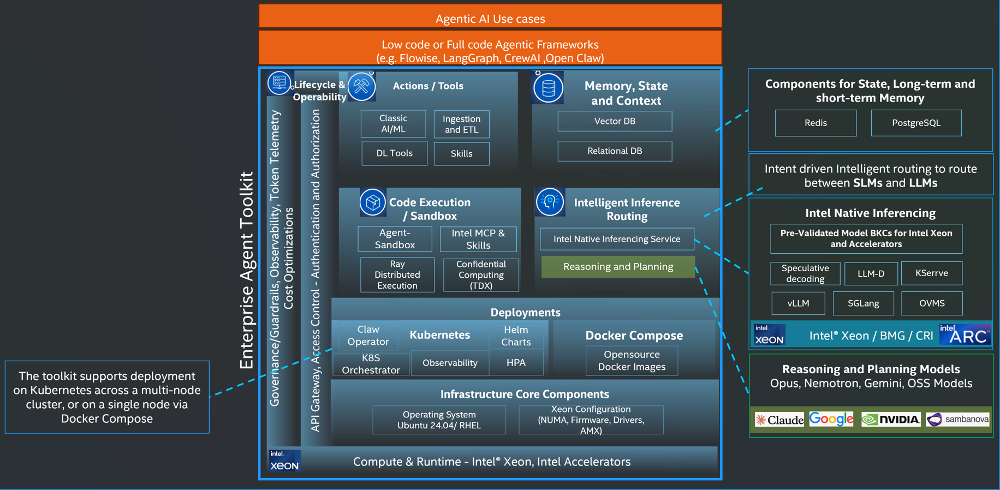

# Meet the Agent Toolkit

[← Docs index](../README.md)

Intel® Agent Toolkit is a Kubernetes layer for running production AI agents on Intel® hardware. It provides the services a model endpoint does not: session and long-term memory, isolated code execution, tool integration, and tracing.

You select the models to serve. The installer deploys the cluster, an OpenAI-compatible gateway, and this toolkit. Applications call the gateway with the same clients they already use for OpenAI: only the base URL and API key change.

<p align="center">
  
</p>

## What is an agent in this stack?

An **agent** is an application that calls a language model and then acts on the result: it may query a database, execute generated code, or invoke an external API, then return that result to the model and continue.

In practice that loop looks like this:

1. The application sends a prompt to a language model through the gateway.
2. The model returns text, a tool call, or generated code.
3. The application (or the agent runtime) executes that action: a database query, a sandbox run, or an external API.
4. The result is sent back to the model, and the loop continues until the task is done.

Orchestration frameworks such as LangGraph and CrewAI implement steps 1, 2, and 4. This toolkit supplies the **infrastructure** for step 3 (memory, sandbox, tools) and for persisting state between steps.

## Which repository to start from

Start with [Stack Manager](https://github.com/intel/enterprise-ai-solutions). It installs, updates, and tears down this toolkit. `./stack-manager` is in that repository.

From a terminal:

```bash
git clone https://github.com/intel/enterprise-ai-solutions.git
cd enterprise-ai-solutions
./stack-manager configure
./stack-manager init agent-toolkit
```

`configure` is a one-time setup of tools the installer needs (Python, `kubectl`, Helm, and so on). `init agent-toolkit` then:

1. Clones this toolkit repository into `ext/` inside the Stack Manager directory.
2. Copies default settings into `env/local/` (YAML files for domain, TLS, models, and cluster inventory).

Edit the files under `env/local/`. Those are the live config the installer reads. Do not treat the YAML inside this GitHub repo as the config you change on a running system.

When the YAML looks right, install:

```bash
./stack-manager install agent-toolkit
```

Stack Manager can also install other software (for example Intel® Chatbot Toolkit, with `init erag`). Those guides live on the [Intel® Software Catalog](https://swcatalog.intel.com/developer/docs/enterprise-rag). The [Deploy](../README.md#deploy) section of this docs index links them.

The rest of this page explains what `install agent-toolkit` puts on the cluster. For the first run, continue with [Prerequisites](../getting-started/prerequisites.md) and the [quickstart](../getting-started/quickstart.md).

## What install brings up

A default install brings these parts up in order. Each part is configurable: you can bring your own cluster, pick the gateway and models, and switch individual toolkit components on or off. See [Configuration](../configuration/configuration.md).

| Part | What it deploys | How you confirm it |
|---|---|---|
| **Platform** | Kubernetes, storage, service mesh, identity, Prometheus / Grafana | `kubectl get nodes` shows Ready |
| **Inference** | Model serving (vLLM or another engine), LiteLLM or the AI gateway, Langfuse | `https://<base_domain_name>/v1/chat/completions` returns a completion |
| **Agent toolkit** (this repository) | Redis, PostgreSQL with pgvector, agent sandbox, MCP templates, optional KubeRay | Agents can store state, execute code, and call tools |

`./stack-manager init agent-toolkit` followed by `install agent-toolkit` installs all three. The toolkit needs Kubernetes and model serving, so a successful install includes both a model API and the agent backends.

## Architecture deep dive

The numbered overview above is the product picture. The diagram below is the request path once the stack is running: the application calls the OpenAI-compatible gateway; behind it are model serving, memory, the sandbox, tools, and observability on Kubernetes.

<p align="center">
  
</p>

## Toolkit components

The install and configuration guides use these names. Each component ships with a default implementation that you can run immediately; a component can be replaced later without rebuilding the rest of the stack.

| Component | Default | Role |
|---|---|---|
| **LiteLLM** | Enabled when `auth_provider: litellm` | HTTPS gateway: one URL, one master key, OpenAI-compatible `/v1/chat/completions` |
| **Redis Stack** | Enabled | Short-term memory: session state, caches, and RediSearch |
| **PostgreSQL + pgvector** | Enabled | Long-term memory: embeddings, RAG, and data that persists across pod restarts |
| **Agent sandbox** | Enabled | An isolated Kubernetes pod per code execution. Generated code does not run on the host |
| **MCP servers** | Enabled, empty list | Templates for registering tools. Nothing is deployed until you add a server |
| **KubeRay** | Disabled | Distributes Python tasks across worker pods. Enable with `kuberay_enabled: true` |
| **Keycloak realm** | Enabled unless `keycloak_enabled: false` | Creates an `agent-toolkit` realm and `agent-toolkit-client` OIDC client on the platform's Keycloak. Does not deploy Keycloak itself |
| **Langfuse** | Enabled with LiteLLM | Trace UI for each LLM call: prompt, tokens, latency, and the model that served the request |

## Deployment commands

After [Prerequisites](../getting-started/prerequisites.md):

```bash
./stack-manager configure
./stack-manager init agent-toolkit
# edit env/local/*.yaml: see Configuration
./stack-manager install agent-toolkit
```

`init` copies this repository's defaults into `env/local/`. Edit that copy; do not treat the files in git as live configuration. Run `install` again to resume a failed install. Toolkit components that are already installed (Redis, pgvector, sandbox, KubeRay) are skipped, so a changed setting for one of them does not take effect on a re-run: see [Decommission and redeploy](../deployment/decommission.md).

## Request flow

1. The application calls `https://<base_domain_name>/v1/chat/completions` with the LiteLLM master key.
2. LiteLLM authenticates the key. When guardrails are enabled, a safety model screens the prompt before the main model sees it.
3. The request is sent to the named model, or to a router that selects a model. See [Routing](../configuration/routing.md).
4. vLLM running on Intel® hardware generates the completion.
5. If the agent then needs memory or code execution, it calls Redis, pgvector, or the sandbox **inside the cluster**. Those services are not exposed on the public gateway URL.

In-cluster URLs are listed in the [Backend connection reference](../reference/backend-connections.md).

## What this toolkit is not

This toolkit is not LangGraph, CrewAI, or LangChain. Those frameworks run **on top of** the gateway: you point them at `https://<base_domain_name>/v1` the same way you would point them at OpenAI.

It is not a hosted model API. Models run on your hosts, on Intel® hardware. A GPU is not required. You can still register a GPU or cloud endpoint (OpenAI, Anthropic, Gemini) on the same gateway later; that is optional.

## Next steps

If this is the first time you are installing the stack, work through the pages in this order:

1. **[Prerequisites](../getting-started/prerequisites.md)**: hardware, SSH, DNS, and the TLS certificate.
2. **[Quickstart](../getting-started/quickstart.md)**: install on one host and send a chat request.
3. **[Configuration](../configuration/configuration.md)**: the YAML files under `env/local/` when you need to change the default layout.

The [glossary](../reference/glossary.md) defines the terms these pages use. The [FAQ](../faq-and-troubleshooting/frequently-asked-questions.md) answers the questions people ask after a first read. For more than one host, go to [multi-node deployment](../deployment/multi-node.md). After Hello works, copy in-cluster URLs from the [backend connection reference](../reference/backend-connections.md), or turn on [guardrails](../configuration/guardrails.md) and [routing](../configuration/routing.md).
